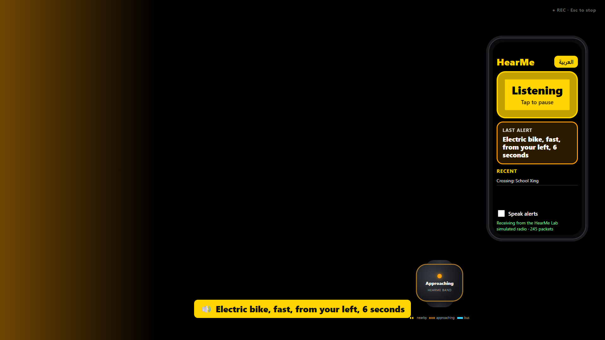

# HearMe

**Electric vehicles are silent. We made them speak.**

WFEO Hackathon 2027 · Challenge 1: Inclusive Mobility
Team: Mohammed Shehadeh (lead), M. Ghaith Ali, Moundir Mekkaoui

Asia and Africa are switching to electric two- and three-wheelers fast, and they are nearly silent.
Blind and low-vision pedestrians cross streets by ear, so this transition removes their main safety cue.
HearMe is a low-cost Bluetooth Low Energy signal: e-bikes, tuk-tuks and buses broadcast a tiny packet
(type, speed, heading, optional position) ten times a second; bus stops and crossings broadcast their
names. A pedestrian's free phone app or vibrating wristband turns that into a directional warning,
*"Electric bike, fast, from your left, 3 seconds"*, or an announcement, *"Bus 12 arriving, front door on
your left"*. No internet, nothing installed on the road. Receivers can upload anonymous, aggregated
counts so a city can see where fast two-wheelers and near misses cluster near schools and stops.

> **This is a fully digital prototype.** No physical hardware was used. The radio, GPS, traffic and
> city data are simulated, and every simulated number is labelled as such.



## What is in the repo

| Path | What it is | Status |
|---|---|---|
| [`protocol/`](protocol/SPEC.md) | Packet spec (31-byte BLE legacy advertising, rolling ID, truncated HMAC), threat model, privacy design, path to a standard. Codecs in C (header-only), TypeScript and Python with shared [test vectors](protocol/test_vectors.json) | ✅ tested |
| [`packages/receiver-core`](packages/receiver-core/src/receiver.ts) | Receiver: RSSI → distance, alpha-beta filter, GPS closest-point-of-approach, ignore→aware→warn→urgent with hysteresis, English + Arabic alert text. Identical ports in [`sim/receiver.py`](sim/receiver.py) and [`firmware/lib/hearme_receiver`](firmware/lib/hearme_receiver) | ✅ C = TS = Python on all traces |
| [`apps/lab`](apps/lab) | **HearMe Lab**: the 3D demo (Vite + React + three.js / react-three-fiber), HRTF 3D audio, simulated BLE radio, director mode | ✅ e2e: 60 fps, 0 console errors |
| [`apps/receiver-pwa`](apps/receiver-pwa/src/PhoneApp.tsx) | Accessible pedestrian phone app (installable PWA, EN/AR, screen-reader live region) | ✅ |
| [`firmware/`](firmware/README.md) | ESP32-C3 vehicle beacon + wristband (PlatformIO), Wokwi setup with serial packet injection, native unit tests | ✅ all envs compile; not run on hardware |
| [`sim/`](sim) + [`docs/results`](docs/results/results.md) | Monte Carlo of 79,400 simulated crossing attempts, charts and results table | ✅ |
| [`apps/dashboard`](apps/dashboard/README.md) | City dashboard: FastAPI + SQLite + React/Leaflet, anonymous aggregates only, top-10 ranking, CSV export | ✅ |
| [`docs/`](docs/architecture.md) | Architecture, Mermaid diagrams (PNG/SVG), schematics (schemdraw), [BOM](docs/bom.md), [power budget](docs/power_budget.md), [maintenance](docs/maintenance.md), [limitations](docs/limitations.md) | ✅ |

## Run it

Requirements: Node 20+ and Python 3.11+ (with `numpy`, `matplotlib`, `fastapi`, `uvicorn`, `pytest`).

```powershell
npm install
npm run dev                      # HearMe Lab on http://localhost:5173
```

Open http://localhost:5173, **put on headphones**, press **Start**. For the linked phone screen, open
http://localhost:5173/phone.html in a second tab of the same browser: it receives the Lab's
simulated radio over a `BroadcastChannel` and runs its own copy of the receiver.

**Director mode** (the scripted 85-second video sequence, rendered at 1920×1080): press **D**, or open
http://localhost:5173/?director=1 and press Start. To record, make the browser full screen on a
1080p display and capture the window. The sequence goes: sighted street → blind mode → silent e-bike,
HearMe OFF → the same bike, HearMe ON → bus arrival → title.

| Key | Action |
|---|---|
| **D** | Start director mode |
| **Esc** | Stop director mode |
| **C** | Burned-in captions on/off |
| B | Blind mode / sighted view |
| H | Cycle HearMe OFF / ON / AVAS sound only |
| 1-4 | Scenarios: School crossing, Bus stop, Busy street at night, Two bikes from both sides |
| P / F / W | Side panel / phone / wristband |
| L | Speech language English / Arabic |
| Space | Pause |
| ? | Shortcut help |

Arabic speech needs an Arabic voice installed in the operating system (Windows: Settings → Time &
language → Speech). Captions and the phone app show the Arabic text either way.

City dashboard:

```powershell
npm --prefix apps/dashboard/web install
npm --prefix apps/dashboard/web run build
python -m uvicorn apps.dashboard.api.main:app --port 8000   # http://127.0.0.1:8000
```

Simulation (about 5 minutes on 19 worker processes; `--quick` for a 25 s smoke run):

```powershell
python sim/montecarlo.py
```

## Tests

```powershell
python tests/run_all_tests.py
```

This runs:

- the Python codec tests;
- the TypeScript codec and receiver tests (vitest);
- the **cross-language check**: C, TypeScript and Python receivers produce identical events on 7 shared traces, plus 28 config variants for C against Python;
- the C codec test;
- the firmware native unit tests;
- the dashboard API tests.

All suites pass. The Lab end-to-end test (Playwright, needs the dev server running) plays director mode
start to finish, fails on any console error, measures frame rate and writes the screenshots in
[`docs/screenshots`](docs/screenshots):

```powershell
$env:LAB_URL = "http://localhost:5173"; node apps/lab/e2e/director.mjs
```

Last run: director completed in 85 s, **60 fps** in director mode, the school scenario and the night
scenario, **0 console errors**. Director narration came from the run itself: *"You heard nothing.
An electric bike just passed 2.1 m in front of you at 26 km/h"*, then *"HearMe warned you 5.7 s before
it passed"*.

## Key simulation results (simulated, not measured)

A Monte Carlo of a blind pedestrian at an unsignalised two-lane zebra crossing with random e-bike traffic
(200 riders/h, riders assumed **not** to yield, phone in pocket). 2,000 attempts per condition, seed
20270101. Full method, parameters with sources, sweeps and caveats: [`docs/results/results.md`](docs/results/results.md).

| Condition | Median warning lead | Warned ≥ 3 s ahead | Conflicts per 1,000 crossings (95% CI) | False alarms per attempt | Mean wait at kerb |
|---|---|---|---|---|---|
| No warning (tyre noise only) | 0.0 s | 0.0% | 193.0 (176.3–210.9) | 0.000 | 2.5 s |
| AVAS-style speaker on the bike | 0.0 s | 0.0% | 193.0 (176.3–210.9) | 0.000 | 2.5 s |
| HearMe, RSSI only | 10.4 s | 99.8% | 74.5 (63.8–86.8) | 11.875 | 37.1 s |
| **HearMe with GPS** | **5.7 s** | **94.0%** | **22.0 (16.4–29.4)** | **0.004** | **4.9 s** |

What the numbers say, and their limits:

- **Conflicts:** HearMe with GPS cut simulated conflicts (a rider within 2 m while the pedestrian is on the road) from 193 to 22 per 1,000 crossings. That is an 89% reduction, with almost no false alarms and a short wait.
- **RSSI-only mode:** it warns early but cries wolf, with about 12 false alarms per attempt. This is mostly riders on a parallel street, which RSSI alone can't tell apart. Pedestrians then wait so long that 14.9% gave up and crossed anyway. Its "lead time" is inflated by noisy early warnings; measured as continuous warning, the two modes are close.
- **Audio baselines:** with the assumed sound levels, neither tyre noise (48 dB(A) at 2 m) nor a 56 dB(A) AVAS speaker is detected against 55–70 dB(A) street noise in time. This rests on assumed values. The background-noise sweep shows AVAS works only in a very quiet street (35 dB(A)).
- **Robustness:** HearMe with GPS stays at 93–95% "warned ≥ 3 s" from 0 to 60% packet loss and from 0 to 20 dB body blocking.

## Honest status

- **Not done:**
  - No physical hardware.
  - The firmware compiles for ESP32-C3 but has not been flashed or run in Wokwi.
  - No user testing with blind pedestrians.
- **Assumptions:** all radio, acoustic and behaviour parameters are cited or marked ASSUMPTION in [`sim/params.py`](sim/params.py) and [`apps/lab/src/config/radio.ts`](apps/lab/src/config/radio.ts).
- **Known receiver weaknesses** found by the simulation, listed in [`docs/limitations.md`](docs/limitations.md):
  - RSSI-only time-to-reach is optimistic.
  - An 8 m pass radius is close to GPS error for the far lane.
  - `warn_ttr_s` = 6 s is shorter than the time needed to cross two lanes.
- **Costs:** $1 per vehicle is realistic only as the added cost inside a vehicle that already has Bluetooth. A retrofit is about $2.5–5, or $4–8 with GPS, at 10,000 units (estimates, [`docs/bom.md`](docs/bom.md)).

## Credits

All sounds are synthesised at runtime and all 3D models are built from primitives. See
[`apps/lab/ATTRIBUTION.md`](apps/lab/ATTRIBUTION.md).
