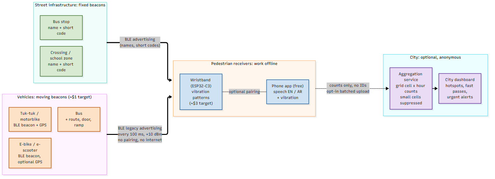
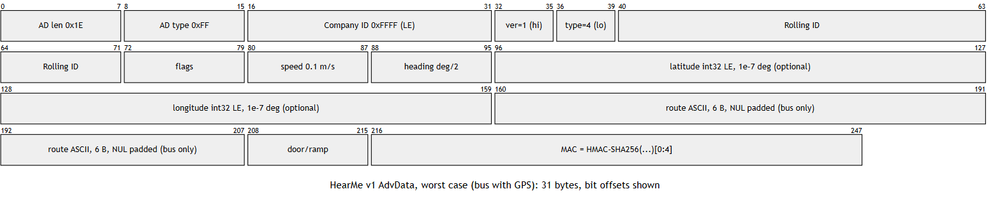
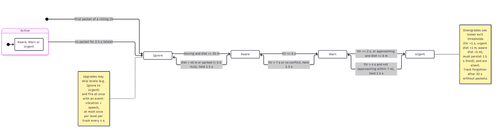
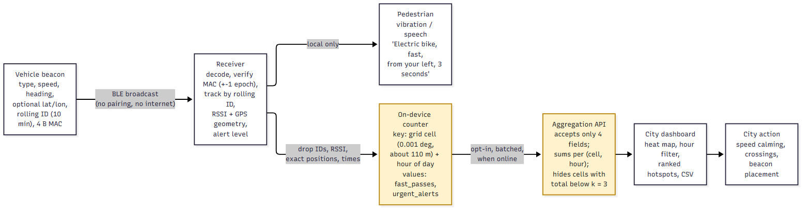
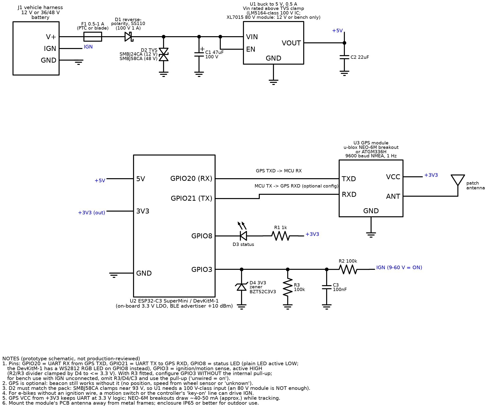
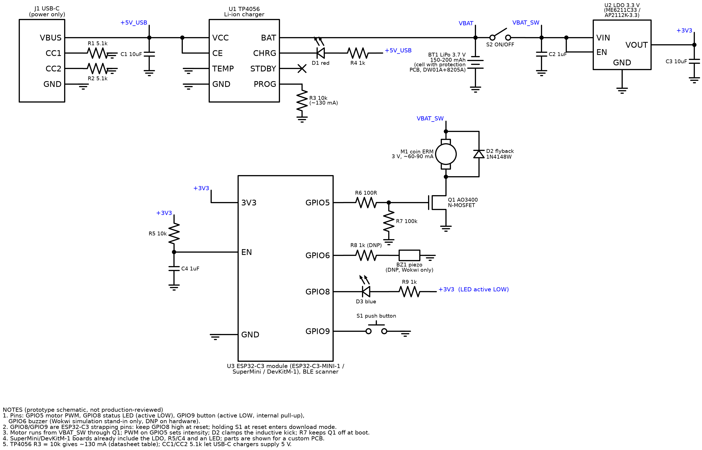
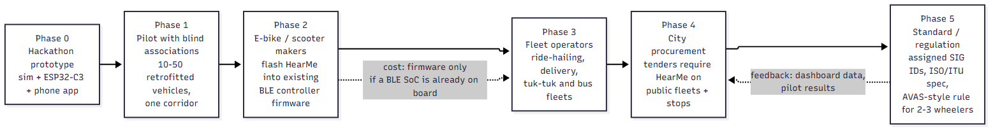

# HearMe technical design

WFEO Hackathon 2027, Challenge 1 (Inclusive Mobility). Team: Mohammed Shehadeh
(lead), M. Ghaith Ali, Moundir Mekkaoui.

**Problem.** Asia and Africa are electrifying two- and three-wheelers fast. Electric
bikes, scooters and tuk-tuks are nearly silent, and blind and low-vision pedestrians
rely on hearing to judge traffic.

**Idea.** Make quiet vehicles announce themselves by radio. A low-cost Bluetooth Low
Energy beacon on each vehicle broadcasts type, speed, heading and optional position
ten times a second; bus stops and crossings broadcast their names. A pedestrian's
~$3 vibrating wristband or a free phone app turns this into a directional warning:
*"Electric bike, fast, from your left, 3 seconds."* No internet, no pairing, nothing
installed in the road.

## 1. System architecture



| Part | Role | Where in the repo |
|---|---|---|
| Protocol v1 | 12-27-byte BLE legacy advertisement, rolling ID, 4-byte MAC | `protocol/SPEC.md`, codecs in `protocol/python`, `protocol/c`, `protocol/ts`, vectors in `protocol/test_vectors.json` |
| Vehicle beacon | ESP32-C3 + optional GPS, powered from the vehicle battery | firmware `firmware/` (env `vehicle_beacon`), schematic `docs/schematics/vehicle_beacon.png` |
| Infrastructure beacon | same hardware or a programmable commercial beacon; name + short code | `protocol/SPEC.md` section 3.6 |
| Receiver core | decode, verify, track, RSSI and GPS geometry, alert levels, EN/AR text | `sim/receiver.py` (reference), `packages/receiver-core` (TypeScript), `firmware/lib/hearme_receiver` (C); identical events on `tests/traces` |
| Wristband | ESP32-C3 BLE scanner, vibration motor, button, LED | firmware env `wristband` (and `wristband_wokwi` for simulation), schematic `docs/schematics/wristband.png` |
| Phone app | free receiver with speech | `apps/receiver-pwa` |
| Simulation / lab | street-crossing world, radio and GPS models, scenario traces | `sim/`, `apps/lab` |
| City dashboard | anonymous aggregate counts per grid cell and hour | `apps/dashboard` |

## 2. Packet



Common 8-byte header (version/type, 4-byte rolling ID, flags, speed in 0.1 m/s,
heading in 2-degree steps), optional 8-byte position (int32 1e-7 degree), a bus
payload (route, door, ramp) or an infrastructure payload (short code, 12-character
name), and a 4-byte truncated HMAC-SHA256. The largest packet, a bus with GPS, fills
the 31-byte legacy advertising payload exactly. Full byte tables: `protocol/SPEC.md`.

Design choices:

- **Legacy advertising** because every BLE receiver, including old phones and the
  cheapest chips, can scan it. BLE 5 extended advertising is the v2 path.
- **Broadcast only, no connections**: a vehicle passes a pedestrian in a few seconds;
  there is no time to pair or connect, and broadcasting scales to any number of
  listeners.
- **Speed and heading on air** let a receiver predict the closest point of approach
  instead of guessing from signal strength.
- **Position optional**: with it, the receiver knows the side and time-to-reach; without
  it, it falls back to RSSI trend (approaching or not, how fast).

## 3. Receiver algorithm



Per packet: RSSI moving average, log-distance distance estimate, alpha-beta filter for
distance and closing rate. In GPS mode, the closest point of approach of the vehicle's
straight-line path is computed; a vehicle passing within 8 m is a conflict and the
time to that point is the time-to-reach. Levels: *aware* within 35 m, *warn* at
<= 6 s, *urgent* at <= 3 s or when approaching within 6 m. Upgrades alert at once;
downgrades need looser thresholds for 1.5 s, so alerts do not flicker. Buses and
places are announced separately. Unverified packets still warn (fail-safe). Details
and defaults: `protocol/SPEC.md` section 8.

Alert outputs: wristband vibration patterns (intensity and rhythm by level); phone
speech in English and Arabic.

## 4. Data flow and privacy



Everything safety-related happens on the receiver, offline. Optionally, and only with
the user's consent, the receiver uploads counts per (grid cell of 0.001 degree, about
110 m; hour of day): fast passes and urgent alerts. The dashboard API accepts these
four fields and nothing else, sums them on arrival, and hides cells with a total below
3. No vehicle or pedestrian identifiers exist anywhere in the pipeline. Rolling IDs
change every 10 minutes. Full privacy design and threat model: `protocol/SPEC.md`
sections 9 and 10.

## 5. Hardware

| | Vehicle beacon | Wristband |
|---|---|---|
| MCU | ESP32-C3 (SuperMini / DevKitM-1) | ESP32-C3 (production: lower-power BLE SoC) |
| Power | 12 V or 36/48 V vehicle battery -> fuse, reverse-polarity diode, TVS -> 100 V-class buck -> 5 V | 150-200 mAh LiPo, TP4056 USB-C charger, 3.3 V LDO |
| I/O | GPS on UART (GPIO 20 RX / GPIO 21 TX), ignition/motion sense GPIO 3, LED GPIO 8 | motor PWM GPIO 5 via AO3400, LED GPIO 8, button GPIO 9, buzzer GPIO 6 (simulation only) |
| Schematic |  |  |

Pin notes and regeneration: `docs/schematics/README.md`.

## 6. Cost, power and operations

- **Cost** (`docs/bom.md`, estimates): about $1 is realistic as the extra cost when
  HearMe is built into a vehicle that already has a BLE chip (firmware only, or a
  sub-dollar BLE SoC). A stand-alone retrofit costs a few dollars ($2.5-5 without GPS,
  $4-8 with GPS at 10k units). Wristband about $3-4.5 at 10k units.
- **Power** (`docs/power_budget.md`, approximate): the beacon uses ~0.3 W while riding
  (well under 1 % of an e-bike pack per day) and must sleep with GPS off when parked.
  An ESP32-C3 wristband needs duty-cycled scanning and nightly charging; a
  production band on an nRF52-class SoC could last about a week or more.
- **Operations** (`docs/maintenance.md`): owners for beacons, keys and stop data;
  key rotation with overlap; health checks that do not create tracking data.

## 7. Scale-up path



E-bike and scooter makers flash HearMe into BLE firmware they already ship; fleet
operators retrofit; cities require it in procurement and add beacons to stops and
crossings; regulators adopt it as an AVAS-style rule for L-category vehicles (UN R138
and FMVSS 141 cover quiet cars and similar vehicles, not two-wheelers). See
`protocol/SPEC.md` section 12.

## 8. Limitations

The simulation shows the protocol and receiver logic are consistent and plausible
under stated assumptions; it does not prove real-world range, timing, or benefit for
blind users. Phone OS background limits, RSSI variability, GPS in urban canyons,
adoption and alarm fatigue are open. A pilot needs ethics approval, co-design with
blind associations, 10-50 vehicles and agreed success metrics:
`docs/limitations.md`.

## 9. Regenerating the figures

```
# Mermaid diagrams (needs Node.js; downloads @mermaid-js/mermaid-cli and a headless browser)
cd docs/diagrams
for f in *.mmd; do npx -y -p @mermaid-js/mermaid-cli mmdc -i "$f" -o "${f%.mmd}.png" -s 2 -b white; done
for f in *.mmd; do npx -y -p @mermaid-js/mermaid-cli mmdc -i "$f" -o "${f%.mmd}.svg" -b white; done

# Schematics (needs: pip install schemdraw)
python docs/schematics/vehicle_beacon.py
python docs/schematics/wristband.py
```
