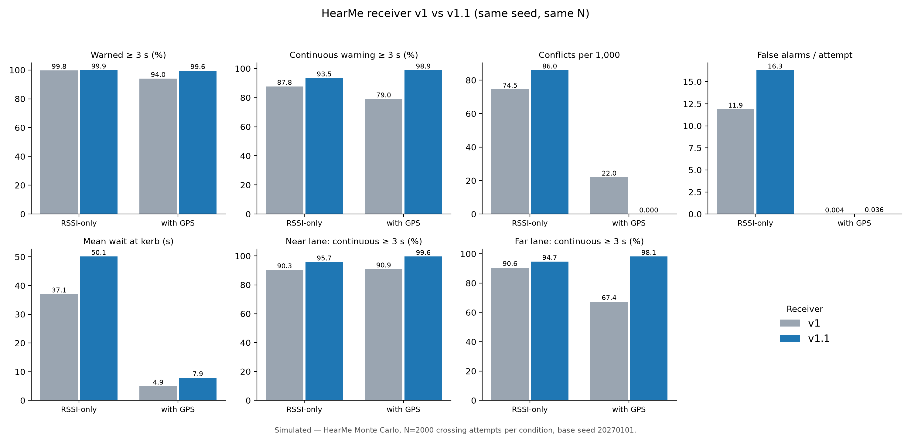
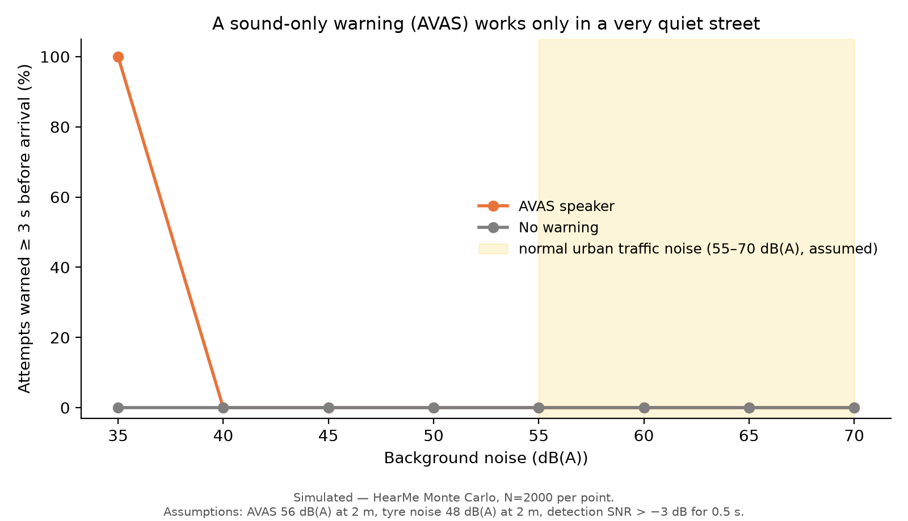

# Receiver v1 → v1.1: Monte Carlo before / after

> **SIMULATED.** Both columns come from `sim/montecarlo.py` with the same base seed (20270101) and the same N (2000 attempts per condition); only the receiver changed. v1: `docs/results/v1/`. v1.1: `docs/results/`.

Receiver v1.1 changes: crossing-aware warning (warn = max(6 s, road 7 m / walk 1.0 m/s + 2 s) = 9 s, urgent 4.5 s), pass radius 8 m + 0.5 × combined GPS error, warn hold while the vehicle is still closing, separate seconds/metres hysteresis, re-escalation always alerts.

| Condition | Metric | v1 | v1.1 |
|---|---|---|---|
| HearMe RSSI-only | Warned ≥ 3 s (%) | 99.8 | 99.9 |
| HearMe RSSI-only | Continuous warning ≥ 3 s (%) | 87.8 | 93.5 |
| HearMe RSSI-only | Conflicts per 1,000 | 74.5 | 86.0 |
| HearMe RSSI-only | False alarms / attempt | 11.875 | 16.311 |
| HearMe RSSI-only | Mean wait at kerb (s) | 37.1 | 50.1 |
| HearMe RSSI-only | Median lead time (s) | 10.36 | 11.45 |
| HearMe RSSI-only | Near lane: continuous ≥ 3 s (%) | 90.3 | 95.7 |
| HearMe RSSI-only | Far lane: continuous ≥ 3 s (%) | 90.6 | 94.7 |
| HearMe with GPS | Warned ≥ 3 s (%) | 94.0 | 99.6 |
| HearMe with GPS | Continuous warning ≥ 3 s (%) | 79.0 | 98.9 |
| HearMe with GPS | Conflicts per 1,000 | 22.0 | 0.0 |
| HearMe with GPS | False alarms / attempt | 0.004 | 0.036 |
| HearMe with GPS | Mean wait at kerb (s) | 4.9 | 7.9 |
| HearMe with GPS | Median lead time (s) | 5.70 | 8.61 |
| HearMe with GPS | Near lane: continuous ≥ 3 s (%) | 90.9 | 99.6 |
| HearMe with GPS | Far lane: continuous ≥ 3 s (%) | 67.4 | 98.1 |

Conflicts per 1,000, 95 % CI — GPS: v1 16.4–29.4, v1.1 0.0–1.9; RSSI-only: v1 63.8–86.8, v1.1 74.5–99.1. Baselines (unchanged, no receiver involved): no warning 193.0, AVAS 193.0 conflicts per 1,000.

Audio baselines (receiver-independent): an AVAS-style speaker warned ≥ 3 s ahead in 100.0 % of attempts at 35 dB(A) background, 0.0 % at 40 dB(A) and 0.0 % at 60 dB(A): it works in a very quiet street and fails in normal traffic noise.
