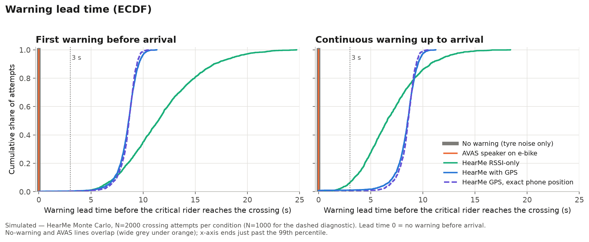
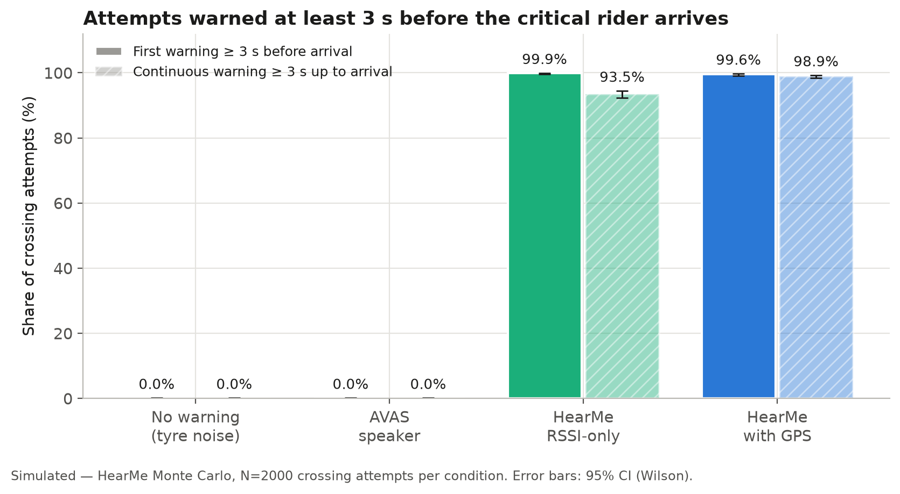
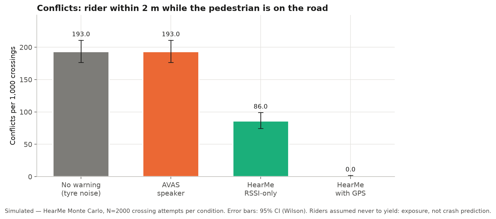
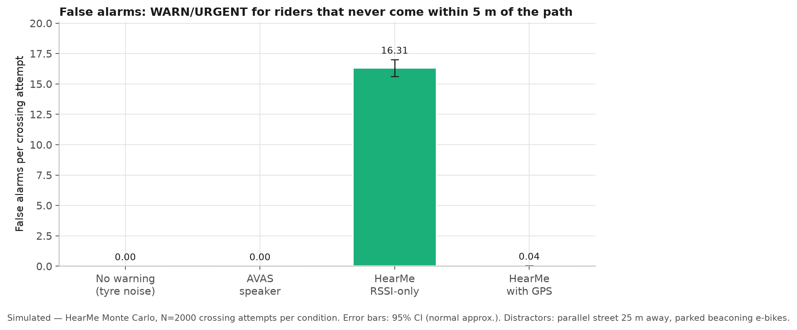
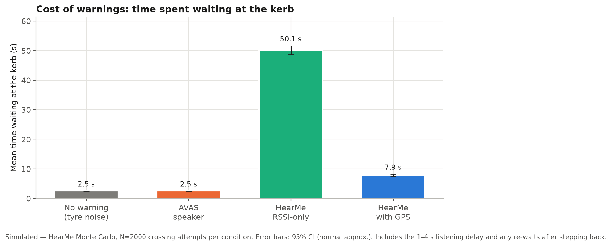
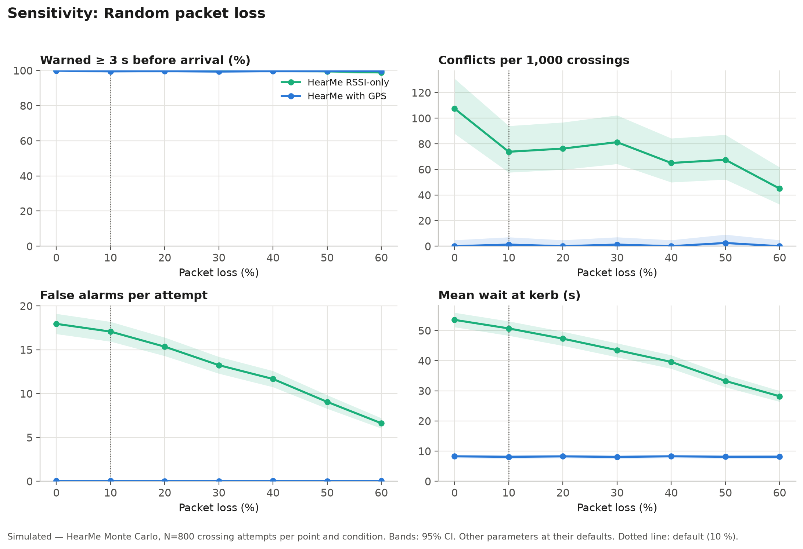
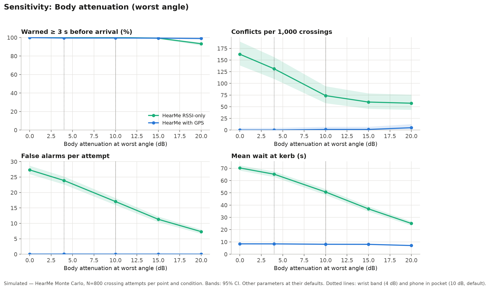
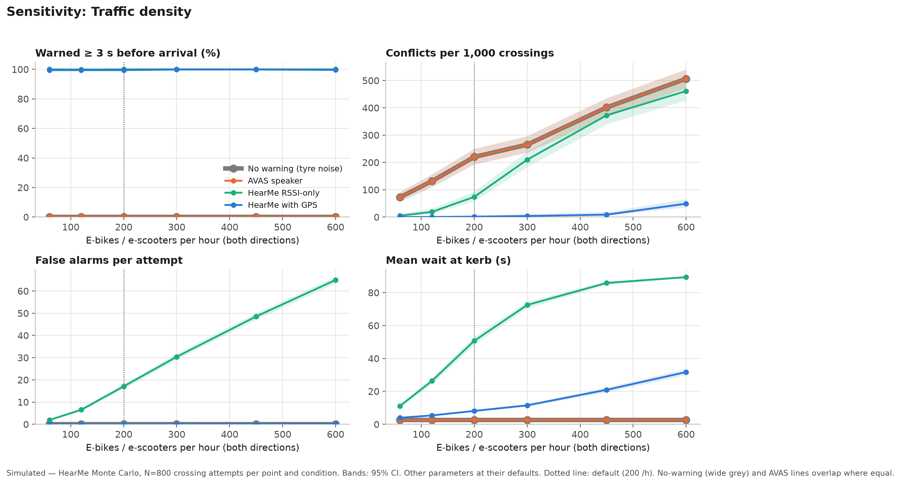
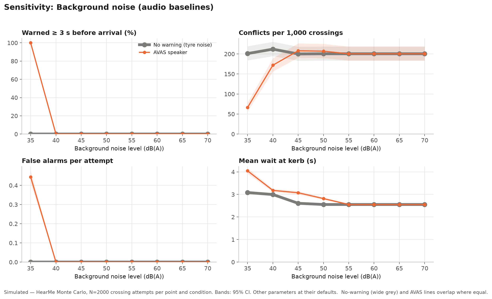

# HearMe Monte Carlo — simulated results

> **SIMULATED.** Every number on this page comes from `sim/montecarlo.py` (base seed 20270101,
> 79400 simulated crossing attempts in total, 416.1 s on 19 worker processes).
> Nothing here is field data. Raw numbers: [`results.json`](results.json).

## 1. What was simulated

A blind pedestrian arrives at an unsignalised zebra crossing of a two-lane road (lanes at y = −1.75 m and +1.75 m,
road edge ±3.5 m) and waits at the south kerb (y = −4.5 m) facing north. E-bikes and e-scooters arrive as
independent Poisson streams in both directions, at constant speed, and **never yield** (worst case: a "conflict" is
exposure — a rider within 2 m of the pedestrian while the pedestrian is on the road — not a crash prediction).
Distractor traffic is present so false alarms can be measured: a parallel street 25 m
north and parked (speed 0) e-bikes that keep beaconing near the kerb.

Each attempt is simulated at 10 Hz from 15 s before the pedestrian reaches the kerb until they have
crossed and the critical rider (the first rider to reach the crossing line after the pedestrian's kerb arrival)
has arrived. The same traffic, pedestrian and noise draws are reused across the conditions (common random numbers,
one `SeedSequence` per attempt), so differences between conditions are not sampling noise in the traffic.

**Conditions**

1. **No warning** — the pedestrian hears only tyre/drivetrain noise. Level at the ear = source level at 2 m −
   20·log10(d / 2 m); a rider is *detected* once SNR = level − background > -3 dB has held for
   0.5 s. Background noise is drawn per attempt.
2. **AVAS speaker** — same model with an AVAS-style source level.
3. **HearMe RSSI-only** — the real receiver core (`sim/receiver.py`) with `Config(use_position=False)`; beacons
   carry type, speed and heading but no position.
4. **HearMe with GPS** — the receiver with its default config; beacons carry their GPS position (1 Hz fixes,
   Gauss-Markov error, dead-reckoned between fixes, `sim/world.py`). The phone's own position also has GPS error.

For both HearMe conditions every advertising event (100 ms + 0–10 ms advDelay) of every beacon within
150 m goes through `world.Channel` (log-distance path loss, correlated shadowing, fast fading,
random loss, sensitivity cut-off, phone-in-pocket body loss by angle). Surviving packets are rounded to integer RSSI
and fed as decoded `Packet` objects to `Receiver.process_packet`; `Receiver.tick` runs at 10 Hz. (Encoding and the
HMAC check are skipped for speed; they do not change the receiver's decisions when `require_mac` is off.)

**Pedestrian behaviour (deliberately simple)**

- Waits at the kerb for a random start delay (listening), then steps out at the first 10 Hz tick with **no
  threat**: HearMe — no receiver track at WARN or URGENT; audio — no rider currently detected and approaching.
- While crossing, a *new* warning (a WARN/URGENT event, or a new audio detection of an approaching rider) is acted
  on after the reaction time. If the pedestrian is then still in the first (near) half of the road — before the
  centre line — they walk back to the kerb, wait a fresh start delay and try again; otherwise they keep going.
- After 90 s of cumulative waiting they cross regardless and ignore further warnings
  ("gave up").
- Pedestrians in the HearMe conditions rely on HearMe only (their hearing is not added on top).

**Metrics**

- *Lead time*: arrival time of the critical rider at the crossing line minus the time of the first WARN/URGENT for
  that rider (first audio detection for the audio conditions); 0 if there was none before arrival.
- *Continuous lead time*: the same, but measured from the start of the last uninterrupted WARN/URGENT episode (audio:
  detection) that is still running when the rider arrives. This exposes warnings that came early and then dropped out.
- *Warned ≥ 3 s*: share of attempts with lead time ≥ 3 s (Wilson 95 % CI).
- *Conflicts per 1,000 crossings*: attempts in which any rider came within 2 m of the pedestrian
  while the pedestrian was on the carriageway (|y| < 3.5 m), checked on the swept segment of each 0.1 s step (Wilson CI).
- *False alarms*: WARN/URGENT events (audio: detection onsets) between kerb arrival and the end of the crossing for
  riders whose true closest approach to the crossing path is > 5 m (parallel street, parked bikes),
  per attempt.
- *Waiting time*: total time spent waiting at the kerb, including the listening delay and re-waits.

## 2. Parameters

Physical parameters come from `sim/params.py`, scenario parameters from `sim/mc_params.py`.

| Parameter | Value | Source |
|---|---|---|
| Advertising interval | 100 ms + 0–10 ms advDelay | HearMe SPEC; BLE Core Spec v5.3 Vol 6 Part B 4.4.2.2 |
| RSSI at 1 m | -50 dBm | Apple iBeacon spec (-59 dBm at 0 dBm) + SPEC +10 dBm |
| Path-loss exponent | 2.2 | Rappaport, Wireless Communications 2nd ed., Table 4.2 (LOS) |
| Shadowing σ / correlation | 4.0 dB / 0.8 s | Rappaport sec. 4.9.2 range; τ ASSUMPTION |
| Fast fading σ | 2.0 dB | ASSUMPTION |
| Receiver sensitivity | -95 dBm | ESP32-C3 datasheet −98 dBm; ASSUMPTION −95 dBm for phones |
| Packet loss (default) | 10 % | ASSUMPTION (swept 0–60 %) |
| Body loss, phone in pocket / wrist | 10 dB / 4 dB at worst angle | ASSUMPTION within published 5–20+ dB range (swept 0–20 dB) |
| Vehicle GPS error | 2.83 m per axis, τ = 10 s, 1 Hz fixes | GPS.gov smartphone 4.9 m; τ ASSUMPTION |
| GPS speed / heading noise | 0.2 m/s / 5.0° | ASSUMPTION |
| Phone (receiver) GPS error | same model, independent of the vehicle's | ASSUMPTION (pessimistic: real nearby receivers share error) |
| Rider speed | uniform 20–30 km/h | EN 15194 25 km/h cut-off; ASSUMPTION range; same for e-scooters |
| Traffic on the crossing road | 200 /h both directions, Poisson | ASSUMPTION (swept 60–600 /h) |
| E-scooter share | 50 % | ASSUMPTION |
| Rider lateral offset | N(0, 0.3 m) around lane centre | ASSUMPTION |
| Parallel street | 25 m north, 50% of main flow | ASSUMPTION (distractor) |
| Parked beaconing e-bikes | Poisson mean 2, 6–30 m from the crossing | ASSUMPTION (distractor) |
| Riders yield | never | ASSUMPTION (worst case) |
| Road | 2 lanes × 3.5 m; pedestrian waits at y = -4.5 m | ASSUMPTION |
| Walking speed | N(1.0, 0.15) m/s, clipped 0.6–1.4 | MUTCD 2009 4E.06 (1.07 m/s); ASSUMPTION for blind pedestrians |
| Start delay at kerb | uniform 1–4 s | ASSUMPTION |
| Reaction time | 1.5 s | ASSUMPTION |
| Give-up wait | 90 s, then crosses regardless | ASSUMPTION |
| Background noise | uniform 55–70 dB(A) | ASSUMPTION (swept 35–70 dB(A)) |
| E-bike tyre/drivetrain noise | 48 dB(A) at 2 m | ASSUMPTION |
| AVAS speaker | 56 dB(A) at 2 m | UN R138 car levels; ASSUMPTION for a bike |
| Audio detection | SNR > -3 dB for 0.5 s; spreading 20·log10(d/2) | ASSUMPTION |

## 3. Results at the default parameters

| Condition | N | Lead time median (s) | Lead time mean (s) | Warned ≥ 3 s (95 % CI) | Continuous warning ≥ 3 s (95 % CI) | Conflicts / 1,000 (95 % CI) | False alarms / attempt (95 % CI) | Mean wait at kerb (s) |
|---|---|---|---|---|---|---|---|---|
| No warning (tyre noise only) | 2000 | 0.00 | 0.00 | 0.0 % (0.0–0.2) | 0.0 % (0.0–0.2) | 193.0 (176.3–210.9) | 0.000 (0.000–0.000) | 2.5 |
| AVAS speaker on e-bike | 2000 | 0.00 | 0.00 | 0.0 % (0.0–0.2) | 0.0 % (0.0–0.2) | 193.0 (176.3–210.9) | 0.000 (0.000–0.000) | 2.5 |
| HearMe RSSI-only | 2000 | 11.45 | 11.80 | 99.9 % (99.6–100.0) | 93.5 % (92.3–94.5) | 86.0 (74.5–99.1) | 16.311 (15.616–17.007) | 50.1 |
| HearMe with GPS | 2000 | 8.61 | 8.46 | 99.6 % (99.1–99.8) | 98.9 % (98.3–99.3) | 0.0 (0.0–1.9) | 0.036 (0.027–0.045) | 7.9 |
| HearMe GPS, exact phone position | 1000 | 8.64 | 8.51 | 99.7 % (99.1–99.9) | 99.7 % (99.1–99.9) | 0.0 (0.0–3.8) | 0.022 (0.012–0.032) | 7.8 |

Additional numbers:

| Condition | Lead p10 / p90 (s) | Any warning before arrival | Critical rider arrives while pedestrian still at kerb or on road: N, warned ≥ 3 s | Attempts with ≥ 1 false alarm | All WARN/URGENT events / attempt | Step-backs / attempt | Gave up waiting (90 s) | URGENT on fast passes ≤ 5 m |
|---|---|---|---|---|---|---|---|---|
| No warning (tyre noise only) | 0.00 / 0.00 | 0.0 % | 942, 0.0 % | 0.0 % | 0.00 | 0.000 | 0.0 % | 0 / 1035 (0.0 %) |
| AVAS speaker on e-bike | 0.00 / 0.00 | 0.0 % | 942, 0.0 % | 0.0 % | 0.00 | 0.000 | 0.0 % | 0 / 1035 (0.0 %) |
| HearMe RSSI-only | 7.34 / 16.77 | 100.0 % | 1589, 99.9 % | 80.2 % | 54.89 | 2.041 | 31.0 % | 4196 / 4196 (100.0 %) |
| HearMe with GPS | 7.26 / 9.59 | 99.8 % | 1087, 99.5 % | 3.1 % | 5.27 | 0.186 | 0.0 % | 1129 / 1133 (99.6 %) |
| HearMe GPS, exact phone position | 7.49 / 9.41 | 100.0 % | 542, 100.0 % | 2.1 % | 5.17 | 0.172 | 0.0 % | 563 / 563 (100.0 %) |

Where the conflicts come from (counts of attempts with a conflict, main run):

| Condition | Conflicts | with the critical rider | in the far lane | while stepping back | rider warned/detected before the (last) step-out | after giving up waiting | median time from step-out to conflict (s) |
|---|---|---|---|---|---|---|---|
| No warning (tyre noise only) | 386 | 294 | 176 | 0 | 0 | 0 | 4.2 |
| AVAS speaker on e-bike | 386 | 294 | 176 | 0 | 0 | 0 | 4.2 |
| HearMe RSSI-only | 172 | 5 | 70 | 12 | 168 | 164 | 3.7 |
| HearMe with GPS | 0 | 0 | 0 | 0 | 0 | 0 | – |
| HearMe GPS, exact phone position | 0 | 0 | 0 | 0 | 0 | 0 | – |

Charts: [lead time ECDF](lead_time_ecdf.png), [lead time histograms](lead_time_hist.png),
[warned ≥ 3 s](share_ge3s.png), [conflicts](conflicts_per_1000.png), [false alarms](false_alarms.png),
[waiting time](waiting_time.png).

## 4. Sensitivity

Each point uses fewer attempts than the main run (see N in the tables); other parameters stay at their defaults.

### Key numbers

- **Audio baselines.** With the default audibility assumptions (tyre noise 48 dB(A) and AVAS 56 dB(A) at 2 m against 55–70 dB(A) background, detection at SNR > -3 dB), the pedestrian was warned ≥ 3 s ahead in 0.0 % (no warning) and 0.0 % (AVAS) of attempts, and had 193.0 and 193.0 conflicts per 1,000 crossings.
- **HearMe with GPS.** Warned ≥ 3 s ahead in 99.6 % of attempts (median lead 8.61 s), 0.0 conflicts per 1,000 crossings, 0.036 false alarms per attempt, mean kerb wait 7.9 s.
- **HearMe RSSI-only.** Warned ≥ 3 s ahead in 99.9 % of attempts (median first-warning lead 11.45 s; median *continuous* lead 6.58 s), 86.0 conflicts per 1,000, but 16.311 false alarms per attempt (80.2 % of attempts had at least one), 54.89 WARN/URGENT events per attempt in total, a mean kerb wait of 50.1 s and 31.0 % of pedestrians giving up after 90 s.
- **Phone position error (diagnostic).** If the phone knew its own position exactly, HearMe GPS would warn ≥ 3 s ahead in 99.7 % of attempts (vs 99.6 % with independent phone GPS error), 0.0 conflicts per 1,000 (N = 1000).
- **Packet loss, HearMe with GPS.** From 0 % to 60 % loss: warned ≥ 3 s 99.9 % → 99.6 %, conflicts 0.0 → 0.0 per 1,000, false alarms 0.043 → 0.034 per attempt.
- **Packet loss, HearMe RSSI-only.** From 0 % to 60 % loss: warned ≥ 3 s 100.0 % → 98.9 %, conflicts 107.5 → 45.0 per 1,000, false alarms 17.953 → 6.617 per attempt.
- **Body attenuation, HearMe with GPS.** From 0 dB to 20 dB: warned ≥ 3 s 99.9 % → 99.0 %, median lead 8.84 → 7.69 s, conflicts 0.0 → 5.0 per 1,000, false alarms 0.031 → 0.024.
- **Body attenuation, HearMe RSSI-only.** From 0 dB to 20 dB: warned ≥ 3 s 100.0 % → 93.2 %, median lead 16.60 → 6.20 s, conflicts 162.5 → 57.5 per 1,000, false alarms 27.312 → 7.317.
- **Traffic density, No warning (tyre noise only).** From 60 to 600 riders/h: conflicts 72.5 → 506.2 per 1,000, mean wait 2.5 → 2.5 s, gave up waiting 0.0 % → 0.0 %.
- **Traffic density, AVAS speaker on e-bike.** From 60 to 600 riders/h: conflicts 72.5 → 506.2 per 1,000, mean wait 2.5 → 2.5 s, gave up waiting 0.0 % → 0.0 %.
- **Traffic density, HearMe RSSI-only.** From 60 to 600 riders/h: conflicts 5.0 → 461.2 per 1,000, mean wait 11.1 → 89.4 s, gave up waiting 0.2 % → 98.6 %.
- **Traffic density, HearMe with GPS.** From 60 to 600 riders/h: conflicts 0.0 → 48.8 per 1,000, mean wait 3.9 → 31.7 s, gave up waiting 0.0 % → 8.6 %.
- **Background noise, No warning (tyre noise only).** Warned ≥ 3 s by noise level — 35 dB(A): 0.0 %, 40 dB(A): 0.0 %, 45 dB(A): 0.0 %, 50 dB(A): 0.0 %, 55 dB(A): 0.0 %, 60 dB(A): 0.0 %, 65 dB(A): 0.0 %, 70 dB(A): 0.0 %.
- **Background noise, AVAS speaker on e-bike.** Warned ≥ 3 s by noise level — 35 dB(A): 100.0 %, 40 dB(A): 0.0 %, 45 dB(A): 0.0 %, 50 dB(A): 0.0 %, 55 dB(A): 0.0 %, 60 dB(A): 0.0 %, 65 dB(A): 0.0 %, 70 dB(A): 0.0 %.

### Packet loss

| Packet loss | Condition | N | Warned ≥ 3 s | Continuous ≥ 3 s | Lead median (s) | Conflicts / 1,000 (95 % CI) | False alarms / attempt | Mean wait (s) |
|---|---|---|---|---|---|---|---|---|
| 0 % | HearMe RSSI-only | 800 | 100.0 % | 94.5 % | 12.02 | 107.5 (87.9–130.9) | 17.953 | 53.5 |
| 0 % | HearMe with GPS | 800 | 99.9 % | 99.4 % | 8.64 | 0.0 (0.0–4.8) | 0.043 | 8.3 |
| 10 % | HearMe RSSI-only | 800 | 100.0 % | 92.2 % | 11.35 | 73.8 (57.6–94.0) | 17.067 | 50.7 |
| 10 % | HearMe with GPS | 800 | 99.5 % | 98.6 % | 8.64 | 1.2 (0.2–7.0) | 0.031 | 8.1 |
| 20 % | HearMe RSSI-only | 800 | 100.0 % | 91.9 % | 11.23 | 76.2 (59.8–96.7) | 15.350 | 47.3 |
| 20 % | HearMe with GPS | 800 | 99.6 % | 99.0 % | 8.58 | 0.0 (0.0–4.8) | 0.022 | 8.2 |
| 30 % | HearMe RSSI-only | 800 | 100.0 % | 89.4 % | 10.74 | 81.2 (64.3–102.2) | 13.241 | 43.5 |
| 30 % | HearMe with GPS | 800 | 99.4 % | 98.4 % | 8.53 | 1.2 (0.2–7.0) | 0.022 | 8.1 |
| 40 % | HearMe RSSI-only | 800 | 99.9 % | 89.2 % | 9.93 | 65.0 (49.9–84.2) | 11.664 | 39.6 |
| 40 % | HearMe with GPS | 800 | 99.6 % | 99.4 % | 8.48 | 0.0 (0.0–4.8) | 0.049 | 8.3 |
| 50 % | HearMe RSSI-only | 800 | 99.5 % | 89.2 % | 9.36 | 67.5 (52.1–87.0) | 9.055 | 33.3 |
| 50 % | HearMe with GPS | 800 | 99.6 % | 99.5 % | 8.43 | 2.5 (0.7–9.1) | 0.016 | 8.1 |
| 60 % | HearMe RSSI-only | 800 | 98.9 % | 83.6 % | 8.29 | 45.0 (32.7–61.7) | 6.617 | 28.2 |
| 60 % | HearMe with GPS | 800 | 99.6 % | 99.0 % | 8.37 | 0.0 (0.0–4.8) | 0.034 | 8.1 |

### Body attenuation (phone in pocket vs wrist)

| Body loss at worst angle (dB) | Condition | N | Warned ≥ 3 s | Continuous ≥ 3 s | Lead median (s) | Conflicts / 1,000 (95 % CI) | False alarms / attempt | Mean wait (s) |
|---|---|---|---|---|---|---|---|---|
| 0 | HearMe RSSI-only | 800 | 100.0 % | 94.6 % | 16.60 | 162.5 (138.6–189.7) | 27.312 | 70.3 |
| 0 | HearMe with GPS | 800 | 99.9 % | 99.1 % | 8.84 | 0.0 (0.0–4.8) | 0.031 | 8.4 |
| 4 | HearMe RSSI-only | 800 | 100.0 % | 95.2 % | 14.89 | 131.2 (109.6–156.4) | 23.890 | 65.2 |
| 4 | HearMe with GPS | 800 | 99.5 % | 98.5 % | 8.78 | 0.0 (0.0–4.8) | 0.045 | 8.4 |
| 10 | HearMe RSSI-only | 800 | 100.0 % | 92.2 % | 11.35 | 73.8 (57.6–94.0) | 17.067 | 50.7 |
| 10 | HearMe with GPS | 800 | 99.5 % | 98.6 % | 8.64 | 1.2 (0.2–7.0) | 0.031 | 8.1 |
| 15 | HearMe RSSI-only | 800 | 99.4 % | 87.1 % | 8.64 | 60.0 (45.6–78.7) | 11.304 | 36.9 |
| 15 | HearMe with GPS | 800 | 99.4 % | 98.8 % | 8.27 | 1.2 (0.2–7.0) | 0.035 | 8.0 |
| 20 | HearMe RSSI-only | 800 | 93.2 % | 79.6 % | 6.20 | 57.5 (43.4–75.8) | 7.317 | 25.0 |
| 20 | HearMe with GPS | 800 | 99.0 % | 97.9 % | 7.69 | 5.0 (1.9–12.8) | 0.024 | 7.1 |

### Traffic density

| Riders / h | Condition | N | Warned ≥ 3 s | Continuous ≥ 3 s | Lead median (s) | Conflicts / 1,000 (95 % CI) | False alarms / attempt | Mean wait (s) |
|---|---|---|---|---|---|---|---|---|
| 60 | No warning (tyre noise only) | 800 | 0.0 % | 0.0 % | 0.00 | 72.5 (56.5–92.6) | 0.000 | 2.5 |
| 60 | AVAS speaker on e-bike | 800 | 0.0 % | 0.0 % | 0.00 | 72.5 (56.5–92.6) | 0.000 | 2.5 |
| 60 | HearMe RSSI-only | 800 | 100.0 % | 90.8 % | 11.50 | 5.0 (1.9–12.8) | 1.921 | 11.1 |
| 60 | HearMe with GPS | 800 | 99.5 % | 98.4 % | 8.57 | 0.0 (0.0–4.8) | 0.010 | 3.9 |
| 120 | No warning (tyre noise only) | 800 | 0.0 % | 0.0 % | 0.00 | 131.2 (109.6–156.4) | 0.000 | 2.5 |
| 120 | AVAS speaker on e-bike | 800 | 0.0 % | 0.0 % | 0.00 | 131.2 (109.6–156.4) | 0.000 | 2.5 |
| 120 | HearMe RSSI-only | 800 | 99.9 % | 91.4 % | 11.49 | 18.8 (11.4–30.7) | 6.531 | 26.3 |
| 120 | HearMe with GPS | 800 | 99.5 % | 98.9 % | 8.59 | 0.0 (0.0–4.8) | 0.019 | 5.4 |
| 200 | No warning (tyre noise only) | 800 | 0.0 % | 0.0 % | 0.00 | 220.0 (192.7–250.0) | 0.000 | 2.5 |
| 200 | AVAS speaker on e-bike | 800 | 0.0 % | 0.0 % | 0.00 | 220.0 (192.7–250.0) | 0.000 | 2.5 |
| 200 | HearMe RSSI-only | 800 | 100.0 % | 92.2 % | 11.35 | 73.8 (57.6–94.0) | 17.067 | 50.7 |
| 200 | HearMe with GPS | 800 | 99.5 % | 98.6 % | 8.64 | 1.2 (0.2–7.0) | 0.031 | 8.1 |
| 300 | No warning (tyre noise only) | 800 | 0.0 % | 0.0 % | 0.00 | 265.0 (235.6–296.7) | 0.000 | 2.5 |
| 300 | AVAS speaker on e-bike | 800 | 0.0 % | 0.0 % | 0.00 | 265.0 (235.6–296.7) | 0.000 | 2.5 |
| 300 | HearMe RSSI-only | 800 | 100.0 % | 93.9 % | 11.25 | 210.0 (183.2–239.6) | 30.371 | 72.5 |
| 300 | HearMe with GPS | 800 | 99.9 % | 99.5 % | 8.62 | 3.8 (1.3–11.0) | 0.052 | 11.5 |
| 450 | No warning (tyre noise only) | 800 | 0.0 % | 0.0 % | 0.00 | 401.2 (367.8–435.6) | 0.000 | 2.5 |
| 450 | AVAS speaker on e-bike | 800 | 0.0 % | 0.0 % | 0.00 | 401.2 (367.8–435.6) | 0.000 | 2.5 |
| 450 | HearMe RSSI-only | 800 | 100.0 % | 94.1 % | 11.23 | 372.5 (339.7–406.5) | 48.536 | 85.9 |
| 450 | HearMe with GPS | 800 | 99.9 % | 99.5 % | 8.60 | 8.8 (4.2–18.0) | 0.079 | 20.9 |
| 600 | No warning (tyre noise only) | 800 | 0.0 % | 0.0 % | 0.00 | 506.2 (471.7–540.8) | 0.000 | 2.5 |
| 600 | AVAS speaker on e-bike | 800 | 0.0 % | 0.0 % | 0.00 | 506.2 (471.7–540.8) | 0.000 | 2.5 |
| 600 | HearMe RSSI-only | 800 | 100.0 % | 94.9 % | 11.45 | 461.2 (427.0–495.9) | 64.957 | 89.4 |
| 600 | HearMe with GPS | 800 | 99.6 % | 98.5 % | 8.51 | 48.8 (35.9–65.9) | 0.138 | 31.7 |

### Background noise (audio baselines only)

| Background dB(A) | Condition | N | Warned ≥ 3 s | Continuous ≥ 3 s | Lead median (s) | Conflicts / 1,000 (95 % CI) | False alarms / attempt | Mean wait (s) |
|---|---|---|---|---|---|---|---|---|
| 35 | No warning (tyre noise only) | 2000 | 0.0 % | 0.0 % | 1.16 | 201.0 (184.0–219.1) | 0.000 | 3.1 |
| 35 | AVAS speaker on e-bike | 2000 | 100.0 % | 100.0 % | 3.99 | 66.5 (56.4–78.3) | 0.444 | 4.0 |
| 40 | No warning (tyre noise only) | 2000 | 0.0 % | 0.0 % | 0.30 | 212.0 (194.6–230.5) | 0.000 | 3.0 |
| 40 | AVAS speaker on e-bike | 2000 | 0.0 % | 0.0 % | 1.95 | 172.0 (156.1–189.2) | 0.000 | 3.2 |
| 45 | No warning (tyre noise only) | 2000 | 0.0 % | 0.0 % | 0.00 | 200.0 (183.1–218.1) | 0.000 | 2.6 |
| 45 | AVAS speaker on e-bike | 2000 | 0.0 % | 0.0 % | 0.75 | 208.0 (190.8–226.3) | 0.000 | 3.1 |
| 50 | No warning (tyre noise only) | 2000 | 0.0 % | 0.0 % | 0.00 | 200.5 (183.5–218.6) | 0.000 | 2.6 |
| 50 | AVAS speaker on e-bike | 2000 | 0.0 % | 0.0 % | 0.08 | 207.0 (189.8–225.3) | 0.000 | 2.8 |
| 55 | No warning (tyre noise only) | 2000 | 0.0 % | 0.0 % | 0.00 | 200.5 (183.5–218.6) | 0.000 | 2.6 |
| 55 | AVAS speaker on e-bike | 2000 | 0.0 % | 0.0 % | 0.00 | 200.5 (183.5–218.6) | 0.000 | 2.6 |
| 60 | No warning (tyre noise only) | 2000 | 0.0 % | 0.0 % | 0.00 | 200.5 (183.5–218.6) | 0.000 | 2.6 |
| 60 | AVAS speaker on e-bike | 2000 | 0.0 % | 0.0 % | 0.00 | 200.5 (183.5–218.6) | 0.000 | 2.6 |
| 65 | No warning (tyre noise only) | 2000 | 0.0 % | 0.0 % | 0.00 | 200.5 (183.5–218.6) | 0.000 | 2.6 |
| 65 | AVAS speaker on e-bike | 2000 | 0.0 % | 0.0 % | 0.00 | 200.5 (183.5–218.6) | 0.000 | 2.6 |
| 70 | No warning (tyre noise only) | 2000 | 0.0 % | 0.0 % | 0.00 | 200.5 (183.5–218.6) | 0.000 | 2.6 |
| 70 | AVAS speaker on e-bike | 2000 | 0.0 % | 0.0 % | 0.00 | 200.5 (183.5–218.6) | 0.000 | 2.6 |

## 5. Interpretation

**1. The audio baselines warn nobody under the default assumptions.** Tyre noise (48 dB(A) at 2 m)
never clears the detection threshold against 55–70 dB(A) background, and the
AVAS source (56 dB(A) at 2 m) only within about 3 m even in the quietest default background — a rider passes
through that zone in less than the 0.5 s detection dwell time, so it is never detected. Both baselines therefore behave identically (193.0 vs 193.0 conflicts per 1,000):
the pedestrian simply steps out after the listening delay. The background-noise sweep shows how strongly this hinges on the
assumed levels: at 35 dB(A) the AVAS speaker gives a ≥ 3 s warning in 100.0 % of attempts
(66.5 conflicts per 1,000) but at 40 dB(A) already 0.0 %; tyre noise at
35 dB(A) is heard only 1.16 s (median) before arrival. Treat the audio baselines as a
"quiet e-bike in normal street noise" bound, not as a measured human hearing performance.

**2. HearMe with GPS gives a consistent ~8.6 s warning with almost no false alarms.** The lead time is set by the
receiver's `warn_ttr_s` = 6 s threshold (median 8.61 s, p10–p90 7.26–9.59 s). Its
remaining 0 conflicts in 2000 attempts: 0 happened while the pedestrian was stepping back
(the step-back rule can walk them into a near-lane rider), and 0 involved a rider that had
*not* been warned before the pedestrian's last step-out (the two groups overlap) — typically a rider still more than 6 s away at
step-out, while a pedestrian at 0.6–1.4 m/s needs about 5–12 s to cross the 7 m carriageway. A WARN horizon shorter than the crossing time is a structural limit of
the current thresholds, not radio failure.

**3. GPS warnings flicker for riders about 6 m to the side.** When the pedestrian is at the kerb, far-lane riders pass about
6.25 m away, inside the receiver's `pass_radius_m` = 8 m but by less than the combined GPS error (vehicle and phone, each
2.83 m per axis). For critical riders arriving while the pedestrian was still at the kerb or on the road, a
*continuous* ≥ 3 s warning was present in 99.6 % of near-lane cases (N = 549) but only
98.1 % of far-lane cases (N = 538); the first warning was ≥ 3 s ahead in 100.0 %
and 99.1 % respectively. With exact phone position (diagnostic row) conflicts drop from 0.0 to
0.0 per 1,000 (overlapping CIs; N = 1000).

**4. RSSI-only "wins" on first-warning lead time for the wrong reason.** Its median first-warning lead (11.45 s) is
longer than GPS (8.61 s) — the opposite of what one would expect — but this is not better ranging. In RSSI-only mode
`receiver.py` treats a track as approaching whenever the filtered range rate shows ≥ 0.8 m/s of closing, and then uses the
*advertised ground speed* (not the closing speed) to compute time-to-reach. Shadowing and fast fading (σ 4 + 2 dB)
move the RSSI-derived range by up to about a factor of two (6 dB ≈ ×1.9 with n = 2.2), i.e. tens of metres for riders
30–100 m away, and near the sensitivity limit only up-faded packets survive, so distant
riders look closer than they are. The result is early, intermittent WARN/URGENT alerts for almost every rider in range, including
receding ones and the parallel street: 54.89 WARN/URGENT events per attempt (GPS: 5.27) and
16.311 false alarms per attempt. Measured from the last uninterrupted warning, the two modes are close
(median continuous lead 6.58 s RSSI-only vs 8.54 s GPS).
The cost is waiting: mean 50.1 s at the kerb vs 7.9 s, and 31.0 % of pedestrians
gave up after 90 s and crossed while ignoring warnings — 164 of RSSI-only's
172 conflicts happened in such forced crossings. In the field this alert rate would very likely be switched off by users.

**5. Sensitivity.** The GPS mode is nearly flat across packet loss 0–60 % and body attenuation 0–20 dB (it needs only a few packets
per second, and position does not depend on RSSI). RSSI-only gets *fewer* false alarms with *worse* radio — 17.95
→ 6.62 per attempt from 0 % to 60 % loss, 27.31 → 7.32
from 0 to 20 dB body loss — because fewer distant packets reach the receiver; another sign its alerts are noise-driven. Traffic
density raises conflicts in every condition (riders never yield); for RSSI-only it also drives waiting time and give-ups up
steeply. All these statements are about the model, under its stated assumptions.

## 6. What this simulation can and cannot show

**It can show**

- How the actual HearMe receiver logic (`sim/receiver.py`, the same algorithm as the TypeScript and C ports) behaves
  against a modelled radio channel, GPS error and realistic packet timing, over thousands of randomised encounters.
- Relative differences between warning strategies under identical traffic, and which parameters (packet loss, body
  blocking, traffic density, background noise) move the result and in which direction.
- Design weaknesses that only appear statistically (false alarms from distractor traffic, missed far-lane riders,
  the waiting-time cost of over-warning).

**It cannot show**

- Real-world safety benefit or crash reduction. Riders never yield or swerve here, so conflicts are exposure counts,
  not crash predictions; real riders often slow down for a pedestrian with a white cane.
- Real radio performance: the channel is a textbook log-distance model with assumed shadowing, body loss and packet
  loss; real phones differ in scan duty cycle, RSSI calibration and background-scan throttling (iOS/Android).
- Real human hearing or behaviour: the audibility model is a broadband SNR threshold with no spectral masking, no
  binaural localisation and no learning; the step-out/step-back rule is a simplification. The audio baselines are
  therefore only as good as the assumed source and noise levels (see the background-noise sweep).
- Cars, buses, tuk-tuks, junctions, turning traffic, groups of riders, overtaking interactions, occlusion by parked
  vehicles, or riders without a beacon (100 % fleet adoption is assumed for the HearMe conditions).
- Rolling-ID changes (every 600 s) during an encounter are not exercised: each attempt fits inside one epoch.

All assumptions are labelled in `sim/params.py` and `sim/mc_params.py`. Re-run with `python sim/montecarlo.py`
(or `--quick` for a smoke test); results are reproducible from the base seed.

## 7. Values passed to the city dashboard generator

`sim/gen_city_data.py` reads `dashboard_rates` from `results.json`: in the HearMe GPS condition
1129 of 1133 fast passes within 5 m of the pedestrian
(99.6 %) produced at least one URGENT alert. The dashboard data built from it is synthetic.
