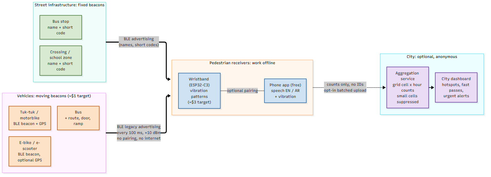
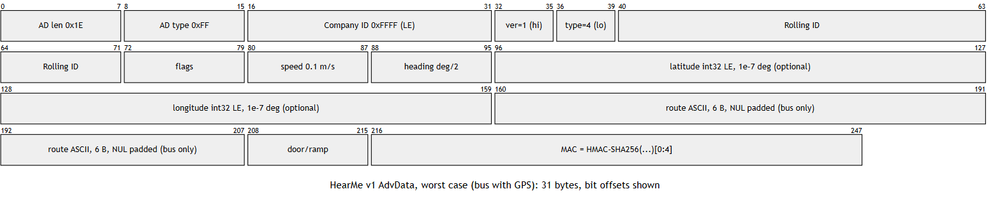
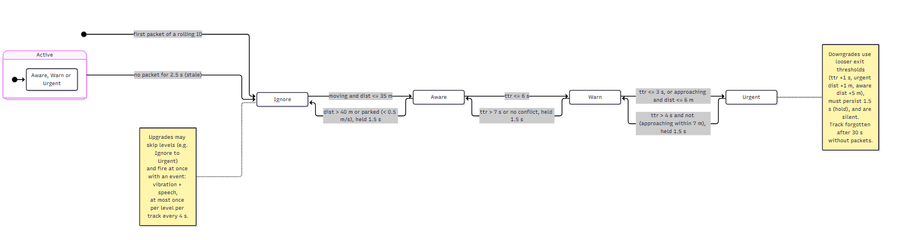
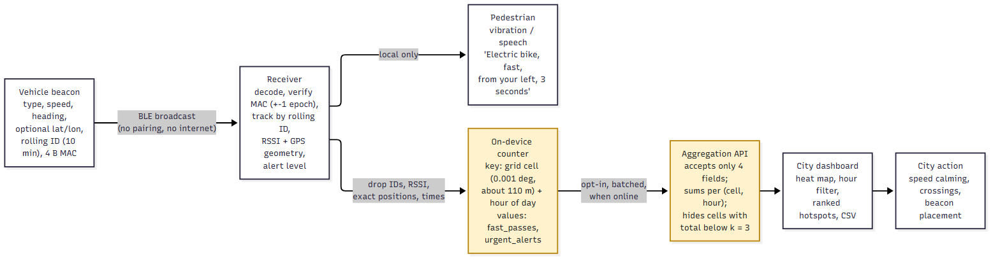
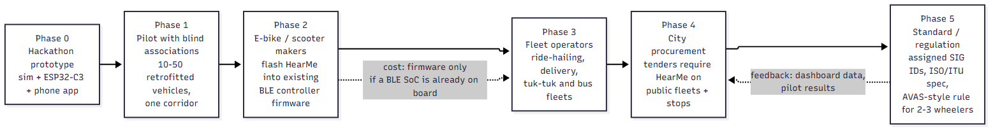

# HearMe Protocol Specification, version 1

Status: **prototype draft** (WFEO Hackathon 2027, Challenge 1: Inclusive Mobility).
Team: Mohammed Shehadeh (lead), M. Ghaith Ali, Moundir Mekkaoui.

Normative reference implementation: `protocol/python/hearme_protocol.py`.
Byte-identical ports: `protocol/c/hearme_packet.h`, `protocol/ts/src/index.ts`.
Conformance vectors: `protocol/test_vectors.json` (generated by `protocol/tools/gen_vectors.py`).
If this document and the reference codec disagree, the codec and the test vectors win
and this document is a bug.

The key words MUST, SHOULD and MAY are used in the RFC 2119 sense.

---

## 1. Overview

Electric two- and three-wheelers (e-bikes, e-scooters, electric tuk-tuks and
motorbikes) are close to silent. Blind and low-vision pedestrians judge traffic by
ear, so a quiet vehicle approaching at 25 km/h is a real hazard.

HearMe makes vehicles *announce themselves by radio instead of by sound*:

- A **vehicle beacon** (target about USD 1 of extra hardware, or zero if the vehicle
  already has a Bluetooth Low Energy chip) broadcasts a small BLE advertisement every
  100 ms: vehicle type, speed, heading, and optionally GPS position.
- **Infrastructure beacons** at bus stops, crossings and school zones broadcast a
  short name and code.
- **Receivers** (a ~USD 3 vibrating wristband, or a free phone app) listen, track each
  vehicle, and warn with direction and time: *"Electric bike, fast, from your left,
  3 seconds"*. Buses are announced (*"Bus 12 arriving, front door on your right"*).
- No internet, no pairing, nothing installed in the road. Receivers MAY upload
  **anonymous aggregate counts** (grid cell, hour of day, fast passes, urgent alerts;
  no identifiers) to a city dashboard.



---

## 2. Transport

| Item | Requirement |
|---|---|
| PHY | Bluetooth LE 1M PHY |
| PDU | Legacy advertising, **ADV_NONCONN_IND** (non-connectable, non-scannable) on primary channels 37, 38 and 39 |
| Advertising interval | **100 ms** nominal for moving vehicles. Per the Core Specification the controller adds a pseudo-random advDelay of 0-10 ms to every advertising event, which de-synchronises beacons |
| Parked / stationary vehicles | MAY slow to 1 s or stop (see `docs/power_budget.md`); MUST return to 100 ms within 1 s of moving |
| Infrastructure beacons | SHOULD use 200-500 ms (they do not move; saves battery on solar/battery stops) |
| TX power | Vehicles: **+10 dBm nominal** (the ESP32-C3 prototype uses its nearest level, +9 dBm). Gives about **-50 dBm at 1 m**, the calibration constant receivers use. Infrastructure: 0 dBm SHOULD be used so names are announced only nearby |
| Advertiser address | Vehicles MUST use a **random non-resolvable private address** and MUST change it at the same moment as the rolling ID (section 6). A static or public address would defeat the rolling ID |
| AdvData | Exactly **one** AD structure: Manufacturer Specific Data (AD type `0xFF`). The **Flags AD is omitted**: the Core Specification Supplement only requires Flags for connectable/discoverable advertising, and omitting it frees 3 bytes |
| Company identifier | **`0xFFFF`** in this prototype. The Bluetooth SIG reserves 0xFFFF for internal use and testing; it MUST NOT be used in shipped products. A real deployment needs a SIG-assigned company identifier (or a SIG-assigned 16-bit service UUID carried in a Service Data AD, which has the same 4-byte overhead) |

### 2.1 Size budget

Legacy AdvData is limited to 31 bytes. One AD structure costs 4 bytes of overhead
(length, AD type `0xFF`, 2-byte company ID), leaving **27 bytes for the HearMe body**.
The largest packet, a bus with GPS, is exactly 27 bytes.

Sizes from `protocol/test_vectors.json`:

| Packet | Body (bytes) | Full AdvData (bytes) | Example vector |
|---|---|---|---|
| Vehicle, no position (e-bike, e-scooter, tuk-tuk, car, motorbike) | 12 | 16 | `ebike_braking_no_gps`, `car_unknown_speed` |
| Vehicle with position | 20 | 24 | `ebike_gps`, `escooter_gps`, `tuktuk_reversing`, `motorcycle_max_speed` |
| Bus, no position | 19 | 23 | `bus_long_route_no_gps` |
| Bus with position | **27** | **31** | `bus_route12_gps` |
| Bus stop / crossing / school zone | 26 | 30 | `bus_stop`, `crossing`, `school_zone_long_name` |

Airtime (estimate): a 31-byte legacy ADV_NONCONN_IND is about 47 bytes on air
including preamble, access address, header, AdvA and CRC, i.e. roughly 0.38 ms per
channel at 1 Mbit/s. At 100 ms one beacon occupies about 0.4 % of each channel.
Collisions grow with density: with a simple ALOHA-style estimate, 50 beacons in range
lose roughly 30 % of packets to collisions before any other loss. This is a
calculation, not a measurement; see section 11 and `docs/limitations.md`.

---

## 3. Packet layout

All multi-byte integers are **little-endian**. "Body" means the manufacturer data
*after* the 2-byte company identifier.

```
 AdvData (legacy, max 31 bytes)
 +-----+------+-----------+------------------------------------------------------+
 | len | 0xFF | 0xFF 0xFF |                HearMe body (12..27 bytes)            |
 |  1  |  1   |  2 (LE)   |                                                      |
 +-----+------+-----------+------------------------------------------------------+

 HearMe body
 +--------+-----------+-------+-------+---------+ - - - - - - - - - + - - - - - - - - - - + -------+
 | ver|ty | rolling ID | flags | speed | heading | lat  i32 | lon i32| type payload       |  MAC   |
 |   1    |     4      |   1   |   1   |    1    |    4    |   4    | bus 7 / infra 14   |   4    |
 +--------+-----------+-------+-------+---------+ - - - - - - - - - + - - - - - - - - - - + -------+
 byte 0    1..4         5       6       7         optional (flags     only for bus and      last 4
 <---------- common header, 8 bytes ---------->   bit 2), 8 bytes     infrastructure types   bytes
```

Worst case (bus with GPS), bit offsets in the full AdvData:



### 3.1 Common header (8 bytes, all types)

| Offset | Size | Field | Encoding |
|---|---|---|---|
| 0 | 1 | version / type | high nibble = version (**1**); low nibble = type code (table 3.2) |
| 1 | 4 | rolling ID | 4 opaque bytes (section 6). Shown as 8 lowercase hex digits in byte order |
| 5 | 1 | flags | bit field (table 3.3) |
| 6 | 1 | speed | uint8, **0.1 m/s** per unit, 0-254 (0 to 25.4 m/s = 91.4 km/h); **255 = unknown**. Encoder rounds half up and clamps to 254 |
| 7 | 1 | heading | uint8, **degrees / 2**, 0-179 (0-358 degrees, compass: 0 = north, 90 = east); **255 = unknown**; 180-254 are invalid and MUST be rejected. Encoder: `round((deg mod 360) / 2) mod 180` |

### 3.2 Type codes

| Code | Type | Class | Extra payload |
|---|---|---|---|
| 0 | `e_bike` | vehicle | none |
| 1 | `e_scooter` | vehicle | none |
| 2 | `tuk_tuk` | vehicle | none |
| 3 | `car` | vehicle | none |
| 4 | `bus` | vehicle | bus payload, 7 bytes |
| 5 | `bus_stop` | infrastructure | infrastructure payload, 14 bytes |
| 6 | `crossing` | infrastructure | infrastructure payload, 14 bytes |
| 7 | `school_zone` | infrastructure | infrastructure payload, 14 bytes |
| 8 | `motorcycle` | vehicle | none |
| 9-15 | reserved | | decoders MUST reject in v1 |

### 3.3 Flags (byte 5)

| Bit | Mask | Name | Meaning |
|---|---|---|---|
| 0 | 0x01 | BRAKING | vehicle is braking |
| 1 | 0x02 | GPS_VALID | the position fix is current and trustworthy |
| 2 | 0x04 | HAS_POSITION | the 8-byte position block is present |
| 3 | 0x08 | REVERSING | vehicle is reversing (tuk-tuks, buses) |
| 4-7 | 0xF0 | reserved | encoders MUST send 0; v1 decoders ignore them |

HAS_POSITION without GPS_VALID is allowed (a last-known position). Receivers use
position geometry only when **both** bits are set. Infrastructure packets MUST NOT
set HAS_POSITION; decoders reject them if they do (fixed beacons need no position:
the receiver only needs to know it is near).

### 3.4 Optional position block (8 bytes, vehicles only, if HAS_POSITION)

| Offset | Size | Field | Encoding |
|---|---|---|---|
| 8 | 4 | latitude | int32 LE, units of 1e-7 degree (WGS-84), north positive |
| 12 | 4 | longitude | int32 LE, units of 1e-7 degree, east positive |

1e-7 degree is about 1.1 cm, far finer than GPS accuracy; the precision is kept so
the field matches common GNSS libraries without rescaling.

### 3.5 Bus payload (7 bytes, type 4)

| Offset (after header and optional position) | Size | Field | Encoding |
|---|---|---|---|
| +0 | 6 | route | ASCII, NUL-padded, truncated to 6 characters (e.g. `12`, `E400X1`) |
| +6 | 1 | door / ramp | bits 0-1: boarding door (0 front, 1 middle, 2 rear, 3 unknown); bit 2: wheelchair ramp deployed/available; bits 3-7 reserved (0) |

### 3.6 Infrastructure payload (14 bytes, types 5, 6, 7)

| Offset (after header) | Size | Field | Encoding |
|---|---|---|---|
| +0 | 2 | short code | uint16 LE, operator-assigned stop/crossing number (lets an app look up a full, localised name offline) |
| +2 | 12 | name | ASCII, NUL-padded, truncated to 12 characters |

For infrastructure the header speed SHOULD be 0 and heading MAY carry the
orientation of the stop or crossing (255 if not used); v1 receivers ignore both.
v1 names are ASCII only, so Arabic or other scripts must come from the short-code
lookup in the app. This is a known v1 limitation.

### 3.7 MAC (last 4 bytes)

```
MAC = HMAC-SHA256( fleet_key,
                   "HMv1" || epoch (uint32 LE) || company_id (uint16 LE) || body_without_MAC )[0:4]
epoch = floor(unix_time_seconds / 600)
```

Details in section 7.

### 3.8 Decoding rules (normative)

A decoder MUST reject (`DecodeError`) when any of these hold; each case has a
negative test vector:

| Rule | Vector |
|---|---|
| body shorter than 12 bytes (header + MAC) | `too_short` |
| version nibble is not 1 | `bad_version` |
| type code 9-15 | `bad_type` |
| infrastructure type with HAS_POSITION | (codec check) |
| length differs from 8 + (8 if HAS_POSITION) + (7 for bus, 14 for infrastructure) + 4 | `bad_length` |
| heading in 180-254 | `bad_heading` |

MAC failures are not decode errors; they are reported separately (`bad_mac`,
`wrong_epoch_far`) so the receiver can apply its policy (section 8.4).
When scanning, a receiver walks all AD structures and uses the first Manufacturer
Specific Data structure whose company ID matches (`parse_adv`).

---

## 4. Field semantics for senders

- **Speed** comes from GNSS Doppler speed, a wheel-speed sensor, or the motor
  controller. If none is available, send 255. Never invent a speed.
- **Heading** is the direction of travel (not of the vehicle's nose when reversing).
  Send 255 when the vehicle is slower than about 1 m/s, because GNSS heading is noise at
  walking speed.
- **Position** SHOULD be sent when a fix is available (it is what makes "from your
  left" and time-to-reach accurate). It MAY be omitted for privacy or cost; the
  receiver falls back to RSSI-only mode.
- **Stationary vehicles** set speed 0 (receivers treat < 0.5 m/s as parked and do not
  warn) and MAY reduce advertising rate.

---

## 5. Encoding example

Vector `ebike_gps` (epoch 3000000, test fleet key):

```
adv_hex     17 ff ffff 10 c04cbd14 06 48 2d a086240f d4b21621 c64fc19e
            |  |  |    |  |        |  |  |  |        |        +- MAC
            |  |  |    |  |        |  |  |  |        +- lon  555135700 (55.51357 E)
            |  |  |    |  |        |  |  |  +- lat 254052000 (25.4052 N)
            |  |  |    |  |        |  |  +- heading 45 -> 90 deg (east)
            |  |  |    |  |        |  +- speed 72 -> 7.2 m/s
            |  |  |    |  |        +- flags 0x06 = GPS_VALID | HAS_POSITION
            |  |  |    |  +- rolling ID
            |  |  |    +- version 1, type 0 (e_bike)
            |  |  +- company ID 0xFFFF (LE)
            |  +- AD type manufacturer data
            +- AD length 0x17 = 23 (type + company + 20-byte body)
```

---

## 6. Rolling identifier

```
rolling_id(epoch) = HMAC-SHA256( device_secret, "HMid" || epoch (uint32 LE) )[0:4]
epoch = floor(unix_time / 600)          -> changes every 10 minutes
```

- `device_secret` MUST be a random secret of at least 16 bytes generated per device
  at provisioning and never broadcast. It MUST NOT be derivable from anything the
  device transmits (for example its Bluetooth or Wi-Fi MAC address). Deriving it from
  the chip's factory MAC is acceptable only for bench prototypes.
- The ID lets a receiver group the ~10 packets per second of one vehicle into a
  track. It does not identify the vehicle to anyone without `device_secret`.
- The advertiser address MUST change at the same instant (section 2), otherwise the
  BLE address links consecutive IDs.
- All devices switch at the same wall-clock boundaries (multiples of 600 s UTC).
  A receiver seeing a vehicle mid-pass at a boundary starts a new track; the old one
  goes stale after 2.5 s. This can cause one repeated warning; acceptable for v1.
- 32 bits are plenty for local uniqueness (a few hundred vehicles in radio range);
  receivers key tracks by `rolling_id + type`.

---

## 7. Message authentication

### 7.1 Scheme

```
msg = "HMv1" (4 ASCII bytes) || epoch (uint32 LE) || 0xFFFF (company ID, uint16 LE) || body_without_MAC
MAC = first 4 bytes of HMAC-SHA256(fleet_key, msg)
```

- `fleet_key` is a 32-byte symmetric key shared by a **fleet** (an operator, a
  manufacturer, or a city scheme). The prototype uses the public test key in
  `test_vectors.json` (`4865617224d6...0910`). It is public and provides no security.
- The epoch binds a packet to a 10-minute window; the company ID binds it to the
  protocol namespace; the domain tag `"HMv1"` separates MAC inputs from rolling-ID
  inputs (`"HMid"`).
- The MAC covers every body byte before it, including the rolling ID and position.

### 7.2 Verification window

A receiver computes its own epoch from its clock and accepts the MAC if it matches
**any epoch in [epoch - 1, epoch + 1]** (`verify(..., window=1)`). This tolerates
clock error of up to roughly 10 minutes and packets sent near a boundary. The cost:
a recorded packet remains acceptable for 10-20 minutes after it was sent
(the `wrong_epoch_far` vector, 5 epochs off, must fail).

Receivers therefore need UTC to within a few minutes: phones have it; the wristband
gets it from a paired phone or keeps it in its RTC after a sync; beacons get it from
GPS or from the RTC set at provisioning. A receiver without a valid clock MUST
treat all packets as unverified (it cannot verify) and still warn (section 8.4).

### 7.3 Which keys a receiver holds

A receiver can hold several fleet keys (one per operator in the city). It tries each
key; the first match marks the packet *verified* for that fleet. Distributing fleet
keys to every receiver is the main weakness of the scheme; see section 9.

---

## 8. Receiver behaviour (informative, with recommended defaults)

The reference receiver is `sim/receiver.py`; the TypeScript core
(`packages/receiver-core`) and firmware C core (`firmware/lib/hearme_receiver`) are
line-for-line ports checked against the same traces in `tests/traces`.



### 8.1 Pipeline per packet

1. **Decode**; drop malformed packets (counted).
2. **MAC check** with all configured fleet keys, window +-1 epoch. Result: verified
   or unverified. Drop only if `require_mac` is set (default **off**).
3. **Track** by `rolling_id:type` (max 32 tracks; the least recently heard is evicted).
4. **RSSI smoothing**: exponential moving average, weight 0.3 on the new sample.
5. **Distance from RSSI** (log-distance model):
   `d = 10 ^ ((P_1m - RSSI_ema) / (10 n))`, with `P_1m = -50 dBm`, `n = 2.2`.
6. **Alpha-beta filter** on distance (alpha 0.35, beta 0.06) gives a smoothed distance
   and closing rate; distance floored at 0.5 m.
7. **Geometry**
   - *Position mode* (packet has HAS_POSITION and GPS_VALID, and the receiver knows its
     own position and heading): local east/north offset (equirectangular, fine below
     about 1 km), bearing relative to the pedestrian's heading gives the side
     (ahead within +-45 degrees, right 45-135, left -135 to -45, otherwise behind). With
     the vehicle's speed and heading, compute the **closest point of approach (CPA)**.
     If the CPA lies in the future and within **pass_radius = 8 m** of the
     pedestrian, the vehicle is a conflict and **ttr = time to CPA**.
   - *RSSI-only mode*: the vehicle is approaching if the filtered closing rate is at
     least 0.8 m/s (after 3 packets). Then
     `ttr = (d - 3 m) / max(closing rate, broadcast speed)`, floored at 0. Side is
     unknown.
   - A vehicle slower than 0.5 m/s is "parked" and never warns.
8. **Level** (`ignore < aware < warn < urgent`):

   | Level | Enter when (moving vehicles only) |
   |---|---|
   | urgent | ttr <= 3 s, or approaching and distance <= 6 m |
   | warn | ttr <= 6 s |
   | aware | distance <= 35 m |
   | ignore | otherwise |

9. **Hysteresis**: upgrades are immediate. The level a track may *stay* at is computed
   with looser thresholds (ttr +1 s, urgent distance +1 m, aware distance +5 m); a
   downgrade happens only after the lower level has persisted for **1.5 s** (hold
   time). Downgrades are silent.
10. **Events**: an upgrade emits an event (vibration pattern and/or speech) unless the
    same level fired for that track in the last **4 s**. Warn/urgent events carry the
    rounded seconds to reach (minimum 1). Urgent text starts with "Stop!".
11. **Staleness**: no packet for **2.5 s** sets the track to ignore; after **30 s** the
    track is forgotten.

### 8.2 Bus and place announcements

- A bus is announced once per track when within **30 m** and either approaching or
  slower than 3 m/s: *"Bus 12 arriving, front door on your right"*.
- A bus stop, crossing or school zone is announced when within **12 m** (RSSI
  distance), at most once every **120 s** per beacon: *"Bus stop: Al Jurf Stop"*.

### 8.3 Speech

English and Arabic strings are generated for every event (Arabic with correct
gender agreement for "fast/slow" and dual/plural forms for seconds). Example
English output: *"Electric bike, fast, from your left, 3 seconds"*; speed words are
"fast" at >= 5.5 m/s and "slow" below 2.5 m/s.

### 8.4 Fail-safe policy

**Default: unverified packets still warn.** Missing a real vehicle is worse than an
occasional false warning, and a pedestrian's receiver may lack the key or a valid
clock. Verification status is kept per track and can be used to:

- rank alerts (verified first) when several vehicles compete for attention;
- let users opt in to `require_mac` (verified only) if spoofing becomes a real problem
  in their area;
- report spoofing attempts (MAC failures) in aggregate.

### 8.5 Recommended defaults

| Parameter | Default | Source / note |
|---|---|---|
| tx_power_1m | -50 dBm | +10 dBm beacon; see `sim/params.py` |
| path_loss_n | 2.2 | short line-of-sight street links; `sim/params.py` cites Rappaport |
| rssi_alpha | 0.3 | tuning |
| ab_alpha / ab_beta | 0.35 / 0.06 | tuning |
| stale_s / forget_s | 2.5 s / 30 s | |
| pass_radius_m | 8 m | about two lanes |
| danger_radius_m (RSSI mode) | 3 m | |
| aware_dist_m | 35 m | |
| warn_ttr_s / urgent_ttr_s | 6 s / 3 s | |
| urgent_dist_m | 6 m | |
| hysteresis_s / hold_s | 1 s / 1.5 s | |
| min_approach_mps | 0.8 m/s | |
| moving_mps | 0.5 m/s | |
| alert_repeat_s | 4 s | |
| bus_announce_dist_m | 30 m | |
| infra_announce_dist_m / infra_reannounce_s | 12 m / 120 s | |
| require_mac | false | fail-safe |
| max_tracks | 32 | |

These values are prototype tuning against simulated traces, not validated with
blind users; see `docs/limitations.md`.

---

## 9. Threat model

HearMe is a safety aid, so the main risks are **false alarms** (which erode trust),
**missed vehicles**, and **privacy loss** for riders. The design is honest about what
a 4-byte truncated HMAC with shared fleet keys can do: it is a **deterrent against
casual spoofing, not strong security**.

| # | Threat | Attacker | Effect | v1 mitigation | Residual risk / v2 |
|---|---|---|---|---|---|
| T1 | **Spoofing fake vehicles** (cheap BLE board broadcasting invented e-bikes) | prankster, vandal | false warnings, then **alarm fatigue**: users switch it off and are unprotected | MAC with fleet key; receivers track verified status; MAC failures can be counted and reported; optional `require_mac` | 4-byte MAC: forging one packet blind has a 1 in 2^32 chance, but see T5 (key extraction). Unverified packets still warn by default, so a spoofer *can* cause false warnings for users who have not opted into `require_mac`. v2: per-vehicle asymmetric signatures (Ed25519) in extended advertising |
| T2 | **Replay** of recorded genuine packets | anyone with a phone | fake "ghost" vehicle at another place or time | epoch in the MAC; window +-1 epoch rejects packets older than about 20 min; position-carrying packets can be checked for plausibility (packet position should be within radio range, e.g. 150 m, of the receiver's own position) | replay inside the window and at the same place is possible; a relay (record here, rebroadcast there in real time) defeats time checks. v2: shorter epochs, counters, position-bound signatures |
| T3 | **Jamming / suppression** (2.4 GHz noise, flooding channels 37-39 with advertising) | malicious, or simply crowded spectrum | missed warnings | three advertising channels; 10 packets/s give redundancy; receivers can detect "no HearMe traffic but high channel noise" and say "radio warning unavailable" | cannot be prevented by protocol. HearMe is an **additional** cue, never a replacement for cane, dog, or hearing. Same physical-layer limit as any radio system |
| T4 | **Tracking / linkability of riders** | data broker, stalker, operator | movement profiles of a vehicle or person | no persistent identifier; rolling ID and advertiser address rotate every 10 min; position optional; receivers never upload IDs | (a) all devices rotate at the **same fixed epoch boundaries**, so a single vehicle passing a sensor during a rotation can be linked by **position continuity** (old ID stops at point X, new ID starts at X with the same speed and heading) and by RSSI continuity; (b) a stationary sniffer network can follow a vehicle cell-to-cell within one epoch; (c) bus route numbers are public by design. Mitigations: SHOULD drop position for 1-2 s around a rotation; MAY add per-device jitter to the rotation moment (v2: decouple ID epoch from MAC epoch); riders MAY disable position |
| T5 | **Key extraction from receivers** | anyone who buys a wristband or decompiles the app | obtains `fleet_key`, can then forge valid MACs for that fleet (T1 at full strength) | per-fleet keys limit the blast radius; keys rotated (see `docs/maintenance.md`); app stores keys in OS keystore; ESP32-C3 flash encryption and secure boot raise the cost on wristbands | **fundamental to symmetric MACs**: every verifier holds the signing key. A determined attacker *will* extract it. That is why the fail-safe default does not depend on the MAC, and why v2 moves to asymmetric signatures where receivers hold only public keys |
| T6 | **Key extraction from beacons** | thief, rider | same as T5 for that fleet; also `device_secret` lets the attacker link that one vehicle's IDs | flash encryption; per-device secrets | accept: one device compromised = one device linkable |
| T7 | **Tampered or mis-configured beacon** (wrong type, false speed, stuck "parked") | rider avoiding attention, faulty install | under-warning | type and speed are set by firmware/controller, not the rider; health checks (`docs/maintenance.md`) | cannot be proven over the air in v1 |
| T8 | **Malicious infrastructure beacon** (fake bus stop name) | vandal | misleads a blind person | infrastructure signed with a city key; app can cross-check short code against an offline stop list | same symmetric-key limits as T5 |
| T9 | **Dashboard poisoning** (uploading fake counts) | anyone | wrong hotspots on the city map | strict 4-field schema; counts are low-stakes planning data; rate limits per client | v2: anonymous credentials / attestation per receiver; treat dashboard as indicative only |
| T10 | **Upload metadata** (IP address, upload time) | server operator, network | could link uploads to a person | batching, hour-of-day granularity only, no device ID; server should not log IPs | use a relay/proxy; aggregate on-device for longer periods |

### 9.1 Why accept a weak MAC in v1

- Legacy advertising has 31 bytes. A full 32-byte HMAC or a 64-byte Ed25519
  signature does not fit with useful data.
- Truncated MACs are still meaningful against *blind* forgery (2^-32 per attempt) and
  stop casual spoofing with an off-the-shelf beacon app.
- The safety function must not depend on the MAC (fail-safe policy), so the MAC is
  used for ranking and opt-in filtering, not for life-safety decisions.

---

## 10. Privacy design

1. **No persistent identifiers on air.** Rolling ID and advertiser address rotate
   every 600 s. `device_secret` never leaves the beacon.
2. **Receivers keep raw data in memory only** for the life of a track (at most 30 s
   after the last packet).
3. **Receivers never upload IDs**, RSSI, exact positions or timestamps.
4. **Uploads are aggregated counts only.** The prototype dashboard
   (`apps/dashboard/api`) accepts exactly four fields per record and rejects anything
   else: `cell_id` (a 0.001 x 0.001 degree grid cell, about 110 m x 100 m at Ajman's
   latitude), `hour` (hour of day 0-23, not a date), `fast_passes`, `urgent_alerts`.
   Counts are summed into (cell, hour) buckets on arrival; individual uploads are not
   stored.
5. **Minimum-count suppression (k-anonymity style).** Every read endpoint hides a
   cell whose total (fast passes + urgent alerts) is below **k = 3**. This is a count
   threshold on events, not on distinct contributors; a production system SHOULD
   require at least k distinct contributors per cell (for example k >= 5 to 10) and
   coarser cells in sparse areas.
6. **Position is optional** for beacons. Riders, operators or regulators can choose
   RSSI-only mode with reduced direction accuracy.
7. **Data minimisation.** Only what is needed for a warning is broadcast. No rider
   identity, no plate number, no account. Bus route numbers are already public.
8. **Opt-in upload.** Upload is off until the user enables it; the app shows exactly
   what will be sent.
9. **Retention.** Aggregates are planning data; the city SHOULD publish a retention
   period and delete or coarsen old data.

Data flow:



---

## 11. Versioning and extensibility

- The version nibble (byte 0, high 4 bits) is **1**. Decoders MUST reject other
  versions (`bad_version`) rather than guess.
- Type codes 9-15, flag bits 4-7 and door-byte bits 3-7 are reserved for v1.x
  additions that do not change length rules.
- **v2 (planned): BLE 5 extended advertising** (ADV_EXT_IND + AUX_ADV_IND, up to 255
  bytes of AdvData per PDU on the secondary channel, optionally LE Coded PHY for
  longer range). This allows:
  - **Ed25519 signatures** (64 bytes) per packet or per short burst, so receivers
    hold only public keys and key extraction (T5) no longer enables forgery;
  - full-length or UTF-8 names (Arabic stop names on air);
  - vehicle length/width, intended turn, and stop-request fields for buses.
- During a transition, beacons SHOULD send v1 legacy advertising **and** v2 extended
  advertising, because many phones and low-cost receivers scan only legacy
  advertising or scan extended advertising less reliably.
- Density: v2 SHOULD include adaptive intervals (faster when fast and close to
  pedestrians, slower when parked) to limit channel congestion at busy junctions.

---

## 12. Path to a standard

### 12.1 Precedent: acoustic vehicle alerting systems (AVAS)

Regulators already accept that quiet vehicles must warn pedestrians:

- **UN Regulation No. 138** (Quiet Road Transport Vehicles, UNECE WP.29) sets
  minimum sound requirements for electric and hybrid vehicles of categories **M and N**
  (passenger cars, buses, goods vehicles). The EU made AVAS mandatory for new quiet
  M and N vehicles through Regulation (EU) No 540/2014.
- **US FMVSS No. 141** (Minimum Sound Requirements for Hybrid and Electric Vehicles)
  covers light hybrid and electric vehicles (up to 10,000 lb gross vehicle weight
  rating).
- As far as we can determine, neither rule covers **L-category** vehicles (two- and
  three-wheelers such as e-bikes, e-scooters, e-mopeds and electric tuk-tuks), which
  is exactly the fleet growing fastest in Asia and Africa. (Check the current text of
  each regulation before citing it formally; national rules differ.)

Sound-based AVAS also has costs: it adds noise for everyone, is masked by traffic
noise, and is hard to localise for a single quiet bike among cars. A radio beacon
complements it: silent for everyone else, and directional and specific for the
person who needs it.

### 12.2 Proposed routes

1. **Assigned numbers (needed first):** obtain a Bluetooth SIG company identifier or a
   16-bit service UUID for HearMe (or for the standards body that adopts it), and
   publish this specification openly with test vectors.
2. **Industry specification:** submit the format as an open specification through a
   neutral body. Candidate venues (to be confirmed with each body): the Bluetooth SIG,
   an ISO technical committee working on intelligent transport systems or
   accessibility, or ITU-T study groups on accessibility and ICT for transport.
3. **Regulation:** propose an AVAS-like requirement, a new annex, or a national rule
   for L-category electric vehicles: "a quiet electric two- or three-wheeler shall
   broadcast a HearMe-compatible presence beacon while moving". Because most
   e-bike controllers, displays and smart locks already contain a BLE chip, the
   compliance cost can be a firmware change.

### 12.3 Phased adoption



| Phase | Who | What | Cost driver |
|---|---|---|---|
| 0 | HearMe team | simulation, ESP32-C3 prototypes, phone app | done in hackathon |
| 1 | blind associations + one city corridor | pilot with 10-50 retrofitted vehicles (see `docs/limitations.md`) | hardware + ethics + staff |
| 2 | **e-bike and e-scooter makers** | flash HearMe into existing BLE firmware (controller, display, IoT lock) | firmware only, where BLE exists |
| 3 | **fleet operators** (shared scooters, delivery, ride-hailing, tuk-tuk cooperatives, buses) | retrofit beacons; bus stops and crossings get infrastructure beacons | ~$1-5 per vehicle (see `docs/bom.md`) |
| 4 | **city procurement** | tenders for public fleets, shared-mobility licences and bus stops require HearMe | contract clause |
| 5 | **regulators / standards bodies** | AVAS-style rule or standard for L-category vehicles; assigned identifiers | rulemaking |

---

## 13. Conformance

An implementation conforms to HearMe v1 if:

1. for every `valid: true` vector it encodes `fields` + `fleet_key` + `epoch` to
   exactly `payload_hex` and `adv_hex`, and decodes them back to `fields`;
2. it rejects every `failure: "decode"` vector with a decode error;
3. `verify` fails for `bad_mac` at the given epoch and for `wrong_epoch_far`
   (5 epochs away) with window 1;
4. it uses the transport parameters in section 2.

Run: `python -m pytest protocol/python` and the C test in `protocol/c/test`
(the TypeScript codec is checked against the same vectors).
